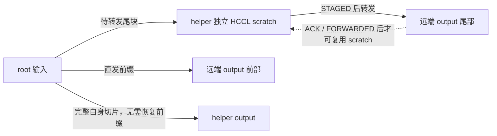

# HCCL Scatter：A21 与赛后优化版

2026 HCCL 通信库创新大赛东北赛区 Scatter 实现：初赛使用 AICPU + TS，决赛使用 CCU。决赛以 A21 为基线，最终提交是它的一个小变体 M（4×3 自拷贝提前）；赛后优化参考了跑分前三 yiran、Bueryy、cc 的公开源码。

仓库里有三份决赛工程：`submitted/` 是平台最终提交（351048，代号 M）的原样 19 个文件，`baselines/a21/` 是提交前的 A21 快照，`final/` 是赛后重构代码。三份的 magic、cache tag 和中转比例都不一样，差异与哈希见[提交包身份](docs/submitted-identity.md)。

`final/` 还没有官方性能成绩，本地验证结果和边界见[验证记录](docs/validation-postrace.md)。复现参赛版本的行为用 `submitted/`；跑本地数值验证要用 `final/`，`tests/` 的驱动按 `final/include/custom.h` 的布局解缓存。

## 代码与记录

| 路径 | 内容 |
|---|---|
| [submitted/](submitted/) | 最终提交 M／351048 的原样源码（19 文件，逐字节来自冻结包） |
| [final/](final/) | 赛后完整 CCU 工程：独立中转缓冲、转发提前、均衡分片、逐通道完成通知 |
| [baselines/a21/](baselines/a21/) | 最终参赛 A21 原始快照，可独立构建；不是后来的 M 候选 |
| [preliminary/](preliminary/) | 初赛完整 AICPU 工程 |
| [提交包身份](docs/submitted-identity.md) | 351048 的来源、19 文件哈希、与 A21 和赛后版的差异、结论边界 |
| [赛后复盘](docs/postmortem.md) | 跑分前三的源码对照、A21 短板、改动及未兑现部分 |
| [验证记录](docs/validation-postrace.md) | 构建、数值/边界、Checker、任务图与性能证据边界 |
| [历史账本](docs/performance-journey.md) | 比赛期间逐版本成绩，保留当时记录并标注修正 |
| [CCU 笔记](docs/ccu-programming-notes.md) | 通知、任务图、双 die 约束 |
| [tests/](tests/) | 数值验证驱动和任务图检查脚本 |

## 成绩基线

2026-09-27 读取的[公开排名 API](https://cannjudge.cn/api/problems/6a98eeb2bf41025d60cde753/ranking?contestId=6a98e72abf41025d60ccb1ee&page=1&size=60)，性能点 19–30，单位 μs：

| 队伍 / 排名 | 分数 | 19 / 20 / 21 | 22 / 23 / 24 | 25 / 26 / 27 | 28 / 29 / 30 |
|---|---:|---|---|---|---|
| yiran / 1 | 389.79 | 9 / 942 / 738 | 9 / 2057 / 1608 | 9 / 917 / 717 | 9 / 1681 / 1316 |
| Bueryy / 2 | 389.70 | 9 / 941 / 738 | 9 / 2059 / 1610 | 9 / 919 / 720 | 9 / 1678 / 1313 |
| cc / 3 | 389.26 | 9 / 944 / 739 | 9 / 2061 / 1612 | 9 / 922 / 722 | 9 / 1682 / 1317 |
| 试一试队 / 18 | 371.34 | 11 / 965 / 757 | 12 / 2064 / 1615 | 11 / 925 / 726 | 13 / 1721 / 1347 |

这是同一时刻的排名快照，不把赛后代码与历史成绩绑定。原 A21 账本中部分大点有取整或不同轮次差异，仍保留在历史账本，不混作同一次测量。前三公开源码的固定 commit、路径和文件 SHA256 见[来源清单](docs/evidence/source-manifest.json)。

## 新版如何改

旧版 helper 借用输出前缀中转，必须经过“写中转 → 转发 → 确认 → 恢复输出”。新版从 `HcclGetHcclBuffer` 获取独立 scratch，把 helper 自己的数据写入与转发数据的生命周期分开。



- 2×8 的中转比例从 `4/10` 调为 FP32 对齐的 `4/11`；4×3 从 `3/4` 调为 `5/6`。这是简化模型的平衡点，实际最优值仍需跑分。
- 中转量受实际 scratch 容量约束；按元素数均衡分片，避免“大块 + 4 字节尾块”的额外整轮开销。
- relay 的 root 自拷贝提前提交，保留完成等待；小消息 Push 逐通道确认 Write 完成后通知接收者，不必等无关通道和自拷贝。
- 4×3 小消息取消末尾 `CONSUMED` 往返，下一轮 `READY` 仍约束输出复用；大消息继续保留完整确认。
- Host 启动参数改用定长数组；保留现有双 die、每 die 至多两个 mission 的资源结构。

不直接照搬前三所有分支：部分公开实现的小消息 Pull 依赖框架同步并省略 Read 完成等待/root ACK。新版继续保留 Pull 的完成与输入生命周期保护；具体差异见复盘。

## 构建与阅读

在 Linux / WSL 的匹配 CANN SDK 环境中：

```bash
source /path/to/Ascend/cann/set_env.sh
cd final
bash build.sh
```

产物为 `final/build/lib64/libhccl.so`。A21 和初赛工程可分别进入对应目录用相同方式构建。当前验证使用 CANN 9.1.0；普通 CPU 运行时间不能代表比赛模拟性能。

主要调用链：`HcclScatter` → `GetResources`（拓扑、通道、scratch、内核注册）→ `ExecOp`（分片、双线程下发）→ CCU kernel。主要修改集中于 `custom.h`、`scatter.cc`、`exec_op.cc`、`ccu_kernel.cc`。

项目基于官方赛题模板，相关代码保留 CANN Open Software License 声明。前三源码仅提供可核验的来源及技术对照，不把其他队伍的成绩或实现记作自己的验证结果。
