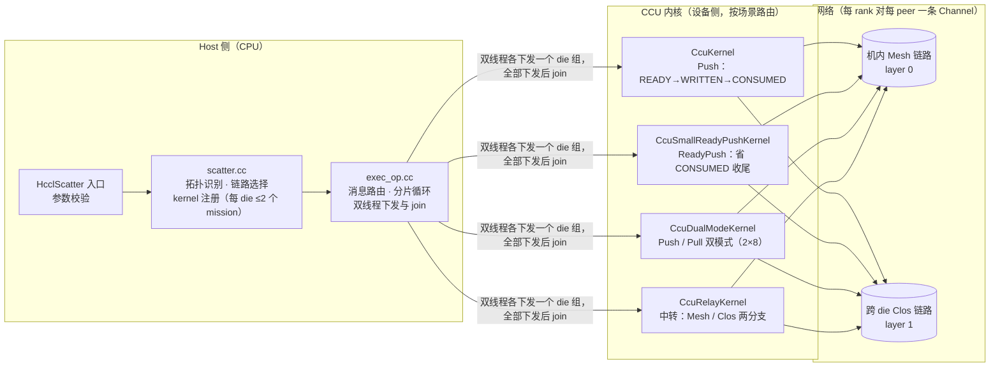
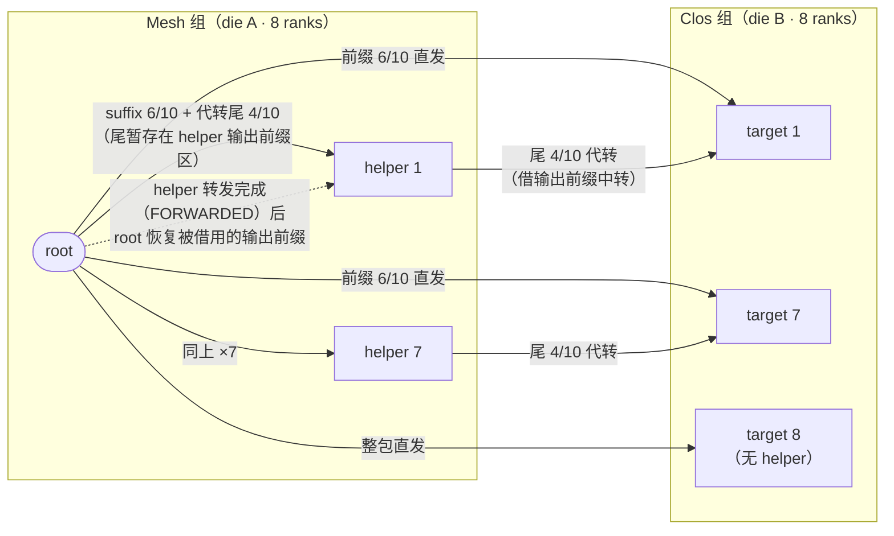
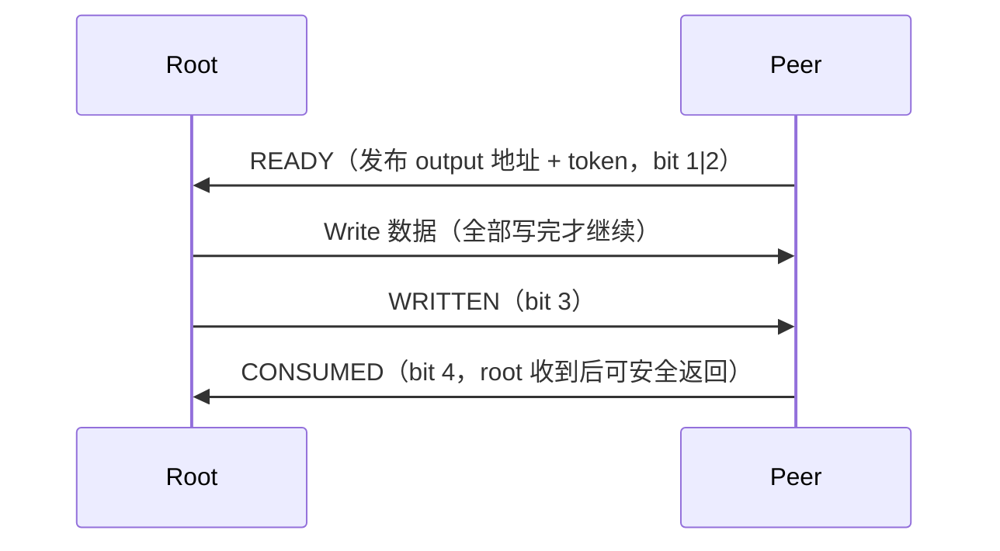

# HCCL Scatter 集合通信算子（2026 HCCL 通信库创新大赛 · 东北赛区）

基于昇腾 CANN 平台的 Scatter 集合通信算子实现与性能优化，覆盖初赛（AICPU + TS 引擎）与决赛（CCU 引擎）两个阶段。决赛排名第 18（三等奖取前 17）。

## 成绩

| 阶段 | 引擎 | 最终提交 | 性能 |
|---|---|---|---|
| 初赛 | AICPU + TS | 255304 | 38μs / 1.13ms / 895μs（固定 1/4 远端分流，大点较基线快 22.6%/22.2%） |
| 决赛 | CCU | A21 | 11/965/757/12/2060/1610/11/925/726/13/1720/1350 μs，12 点距同屏 TBest 平均约 4%（23/24 两点持平 TBest） |

## 这个仓库里有什么

- [preliminary/](preliminary/) — 初赛完整工程（AICPU），选手实现 3 个文件
- [final/](final/) — 决赛完整工程（CCU），选手实现 6 个文件
- [docs/performance-journey.md](docs/performance-journey.md) — 性能优化历程：23 个版本、每个版本的机制与收益账本
- [docs/ccu-programming-notes.md](docs/ccu-programming-notes.md) — CCU 编程踩坑笔记：通知协议、任务图、双 die 约束
- [docs/postmortem.md](docs/postmortem.md) — 赛后复盘：窗口管理教训与方法论沉淀

## 系统架构

决赛四种内核按拓扑与消息规模路由（详见下方数据流与协议）：

| 场景 | 内核 | 要点 |
|---|---|---|
| 2×8 大消息（≥16MiB） | Relay | 双 die 并行 + 7 helper 中转，达到流量模型平衡点 |
| 4×3 大消息 | Relay | 双 die 并行 + 2 helper 中转 + 复制迁 Mesh |
| 2×8 小消息 | DualMode（Pull） | root 发布 source/token，接收者 Read，省 READY 汇合 |
| 其余小消息 | ReadyPush | 逐 peer 准备即写，省 CONSUMED 收尾 |
| 其余大消息 | Push | 完整 READY→WRITTEN→CONSUMED 协议 |

## 技术要点速览

- **拓扑感知路由**：按 layer0 分组识别 2×8（8/8）、4×3（3/3/3/3）、4×1、8+4 四类拓扑，为每种拓扑与消息规模选择不同的数据流
- **双 die 并行**：root 端两个 IO Die 各自独立推进，Host 侧双线程下发 + 完成 join（决赛最大单档收益：大消息 30%–50%）
- **helper 中转与负载均衡**：2×8 下 root 将 7 条机内链交给 7 个 helper 代转 4/11 数据量，与 Clos 直发 4 条链构成 15B/11b 的理想流量平衡
- **协议按消息大小切换**：小消息 Pull（root 发布 source/token，接收者 Read）、ReadyPush（逐 peer 准备即写、省 CONSUMED 收尾）、大消息 Push/中转
- **借输出前缀中转**：helper 借用接收者输出前缀作中转区，转发完成（FORWARDED）后 root 恢复前缀，suffix 写与 restore 依赖解耦
- **流量建模先行**：每个优化前先建关键路径模型（root 出口容量、中转比例平衡点），模型与官测结果互相校准（F11 模型预测 9.1%、实测 8.7%）

## 2×8 大消息数据流（招牌优化）

流量模型（每 rank 数据量 B、机内链带宽 b、root Clos 出口 4b）：

- root 须向 15 个 rank 导出 15B 数据，出口容量为 7 条机内链 + 4 倍 Clos = 11b，**理想下界 `T ≥ 15B / 11b`**
- 7 helper 各代转 rB 时：Mesh 项 `(1+r)B/b`，Clos 项 `(8-7r)B/(4b)`，两项相等处 **r = 4/11** 为平衡点（实现取整数友好的 4/10，实测差异 <1%）
- 该模型预测 9.1%，F11 实测 8.7%（20/21 两点）

## 通信协议

- **Push**（上图）：完整四步握手，大消息带宽主导场景使用
- **Pull**（小消息）：root 直接发布 source 地址 + token，接收者 Read 后回 DONE——省掉"root 等齐所有 READY"的汇合，22 点 14→12μs
- **ReadyPush**（小消息）：逐 peer 准备即 Write，省 CONSUMED 收尾，19 点 12→11μs
- **中转协议**：在上述位之外增加 STAGED / FORWARDED / DONE / ACK / PLAN 位完成 helper 握手，完整位分配与 EventWait 消费型语义见 [docs/ccu-programming-notes.md](docs/ccu-programming-notes.md)

## 代码结构

两份工程均为官方赛题模板的完整可编译工程（CANN Open Software License），选手实现文件已标注：

- 初赛（3 文件）：`custom.h`、`scatter.cc`（Host 资源与链路选择）、`exec_op.cc`（AICPU 内核通信编排）
- 决赛（6 文件）：`custom.h`、`scatter.cc`（Host 链路选择与 kernel 注册）、`exec_op.{h,cc}`（Host 编排）、`ccu_kernel.{h,cc}`（CCU 内核协议）

## 构建与验证

两份工程构建方式一致（官方赛题模板 + CANN Open Software License）：

1. 安装 CANN Toolkit 并设置环境变量：`source /usr/local/Ascend/cann/set_env.sh`（`ASCEND_HOME_PATH` 必须已设置，否则 build.sh 会报错退出）
2. 进入 `final/` 或 `preliminary/` 执行 `bash build.sh`（可选 `--debug`，产物安装到 `build/`）

算子运行依赖昇腾 950 仿真环境（HCCL-VM），普通机器上无法直接跑出性能数据。比赛期间的本地验证矩阵（换 root、换地址、16MiB 门槛两侧、小→大→小、zero、跨片尾块、精确 self 同址）与官测提交纪律见 [docs/postmortem.md](docs/postmortem.md)。

## 阅读指引

- 初赛（AICPU）是决赛（CCU）的简化版，建议先读初赛 3 文件，再读决赛 6 文件
- 一条完整调用链：`HcclScatter`（入口）→ `GetResources`（资源缓存，含拓扑识别与 kernel 注册）→ `ExecOp`（路由 + 分片 + 双线程下发）→ 各 CCU kernel（通信协议）
- 优化怎么一步步来的：23 个版本的机制与逐点账本见 [docs/performance-journey.md](docs/performance-journey.md)

## 关于比赛

2026 HCCL 通信库创新大赛由哈尔滨工业大学主办、华为赞助，赛题为在昇腾 950 仿真环境实现 Scatter 算子（初赛 AICPU、决赛 CCU），评分覆盖多类拓扑（2×8 / 4×3 / 4×1 / 8+4）与消息规模共 12 个性能点。决赛阶段每轮提交有固定官测窗口，成绩以平台逐点用时为准。
